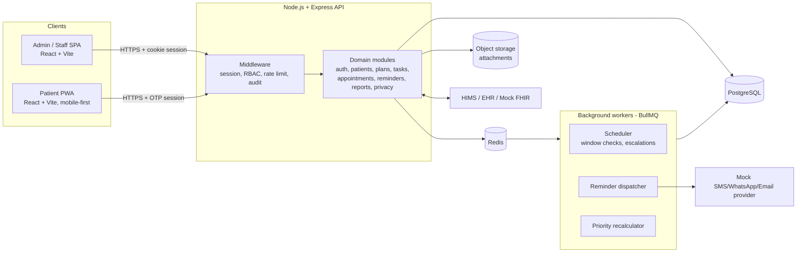
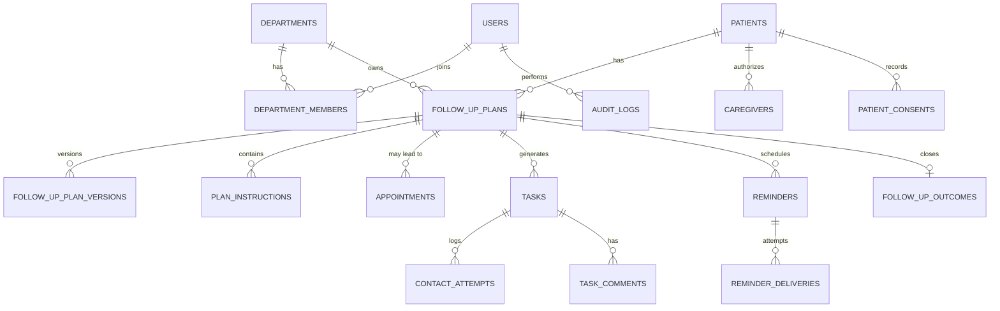
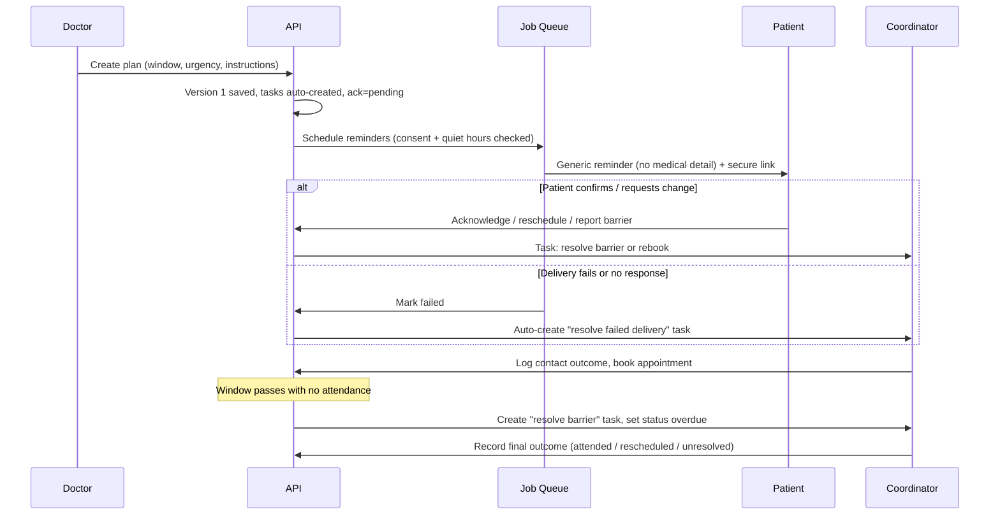

# FollowCare — Architecture

Hospital follow-up management system, modeled on Google Classroom mechanics and adapted for healthcare workflows, privacy and patient engagement.

**Status:** Design baseline for MVP (Steps 1–5). **Scope rule:** administrative follow-up only. No AI clinical diagnosis or triage.

---

## 1. Goals and Non-Goals

**Goals**
- One place (Command Center) that shows every due, overdue or unresolved follow-up and who owns it.
- Treat unreachable or non-returning patients as a *barrier to resolve*, never as "non-compliant".
- Reminders never leak medical data; failed deliveries escalate to staff tasks automatically.
- Mobile-first, low-bandwidth patient access via OTP/secure link.
- Privacy by design: least privilege, minimized data, full audit trail, DPDP-aligned.

**Non-Goals (MVP)**
- Clinical decision support, diagnosis, or clinical triage.
- Full EHR replacement (integrate via HIMS/FHIR stubs instead).
- Billing/claims.

---

## 2. Domain Model: The Classroom Analogy

| Classroom | FollowCare | Backing entities |
|---|---|---|
| Class | Department / Care Team | `departments`, `department_members`, `worklists` |
| Assignment | Follow-up Task | `follow_up_plans` → `tasks` |
| Due date | Follow-up Window | `follow_up_plans.window_start/window_end` |
| Announcement | Patient Reminder | `reminders`, `reminder_deliveries` |
| Submission | Follow-up Outcome | `contact_attempts`, `follow_up_outcomes` |
| Class progress | Follow-up Analytics | views/materialized views + `/reports` |

**Key invariant:** a *follow-up recommendation* (plan) is a different state from a *confirmed appointment*. A plan can exist with no appointment; an appointment links back to a plan.

---

## 3. System Overview



**Deployment shape (MVP):** modular monolith (single Express app + separate worker process, same codebase). Split into services only when a module has independent scaling needs.

---

## 4. Technology Decisions

| Concern | Choice | Rationale |
|---|---|---|
| Frontend | React 18 + Vite + React Router | Fast dev loop, simple SPA hosting |
| Styling | Tailwind CSS | Consistent, high-contrast theme tokens |
| Charts | Recharts | Declarative, enough for dashboards |
| Server state | TanStack Query | Caching, retries, offline-friendly |
| Forms/validation | React Hook Form + Zod (shared schemas) | One validation source for client and server |
| Backend | Node.js 20 + Express | Per spec; simple middleware chain |
| DB | PostgreSQL 15+ | Relational integrity, enums, RLS, JSONB |
| DB access | `pg` + SQL migrations (node-pg-migrate) + thin repositories | Schema stays explicit and reviewable |
| Auth (staff) | Server-side sessions (`express-session` + `connect-pg-simple`), httpOnly/secure/sameSite cookies, optional TOTP MFA | Revocable, no tokens in JS |
| Auth (patient) | OTP (SMS/WhatsApp) or signed single-use secure link → short-lived session | Avoids password burden |
| Queue | BullMQ + Redis (node-cron only for trivial local dev) | Retries, delays, rate limiting, visibility |
| Notifications | Provider interface with `MockProvider` (logs + DB) | Swappable for real SMS/WhatsApp later |
| Files | S3-compatible storage, signed URLs | Keeps blobs out of Postgres |
| Logging | pino + request IDs | Structured, PHI-scrubbed |
| Testing | Vitest (unit), Supertest (API), Playwright (E2E) | Covers RBAC and workflows |

---

## 5. Repository Layout

```
followcare/
├── ARCHITECTURE.md
├── docker-compose.yml            # postgres, redis, api, worker, web
├── package.json                  # npm workspaces
├── packages/
│   └── shared/                   # Zod schemas, enums, permission constants
├── server/
│   ├── package.json
│   ├── migrations/               # 001_enums.sql, 002_core.sql, ...
│   ├── seeds/
│   └── src/
│       ├── index.js              # API entry
│       ├── worker.js             # BullMQ worker entry
│       ├── config/               # env, db, redis, logger
│       ├── middleware/           # auth, rbac, deptScope, audit, rateLimit, errors
│       ├── modules/
│       │   ├── auth/             # login, invite, reset, MFA, patient OTP
│       │   ├── users/
│       │   ├── departments/
│       │   ├── patients/         # profiles, duplicates, merge, caregivers
│       │   ├── plans/            # follow-up plans, versions, attachments
│       │   ├── appointments/
│       │   ├── tasks/            # kanban, comments, transfers
│       │   ├── contacts/         # call attempts, outcomes
│       │   ├── reminders/        # templates, schedule, deliveries
│       │   ├── priority/         # rules engine
│       │   ├── dashboard/        # command center metrics
│       │   ├── reports/
│       │   ├── privacy/          # consent, audit log, access reviews
│       │   ├── messages/
│       │   └── integrations/     # hims, fhir-mock, sms-provider
│       ├── jobs/                 # processors: reminders, windows, escalation, priority
│       └── lib/                  # crypto, masking, pagination, errors
└── web/
    ├── package.json
    ├── vite.config.js
    ├── tailwind.config.js
    └── src/
        ├── main.jsx
        ├── app/                  # router, providers, layouts
        ├── auth/                 # AuthContext, guards
        ├── api/                  # fetch client, query hooks
        ├── components/           # ui kit, Kanban, DataTable, Modal, charts
        ├── features/
        │   ├── command-center/
        │   ├── plans/
        │   ├── tasks/
        │   ├── patients/
        │   ├── appointments/
        │   ├── reminders/
        │   ├── reports/
        │   ├── admin/
        │   └── patient-portal/   # mobile-first views
        ├── offline/              # staff offline queue + sync
        └── i18n/
```

---

## 6. Roles, Permissions and Access Control

**Roles:** `admin`, `doctor`, `nurse`, `coordinator`, `health_worker`, `patient`, `caregiver`.

Access is the intersection of **role permission** AND **department scope** (and, for patient/caregiver, **ownership/authorization**).

| Capability | Admin | Doctor | Nurse | Coordinator | Health Worker | Patient | Caregiver* |
|---|:-:|:-:|:-:|:-:|:-:|:-:|:-:|
| Manage staff/departments/settings | ✔ | | | | | | |
| Create/edit follow-up plans | ✔ | ✔ | ✔ (draft, needs approval) | | | | |
| Approve clinical instructions | | ✔ | | | | | |
| View patient demographics | ✔ | ✔ | ✔ | ✔ | limited | self | per grant |
| View diagnosis/clinical note | | ✔ | ✔ | | | self | per grant |
| View unmasked phone number | | | | on active task only | on active task only | self | |
| Work tasks, log outcomes | ✔ | ✔ | ✔ | ✔ | ✔ | | |
| Book/reschedule appointments | ✔ | ✔ | ✔ | ✔ | ✔ | request only | request only |
| Export reports | ✔ (de-identified) | dept | | | | | |
| View audit logs | ✔ | | | | | own access log | |

\* Caregiver permissions are patient-granted and split into `receive_reminders` and `view_details`.

**Implementation**
- Permission strings (`plan:create`, `patient:view_contact`, `report:export`, …) live in `packages/shared`.
- `requirePermission()` middleware checks the permission; `deptScope()` injects allowed `department_ids` into the request.
- Every repository query on department-owned data takes `department_ids` (never trust client-provided scope).
- PostgreSQL Row-Level Security as defense in depth for `patients`, `follow_up_plans`, `tasks` (session variable `app.department_ids`, `app.user_id`).
- Deactivation: `users.status = 'deactivated'` invalidates sessions immediately (session store purge).

---

## 7. Data Architecture (Step 1 Schema Blueprint)

### 7.1 Enums

| Enum | Values |
|---|---|
| `user_role` | admin, doctor, nurse, coordinator, health_worker, patient, caregiver |
| `user_status` | invited, active, deactivated, locked |
| `urgency_level` | routine, priority, urgent |
| `plan_status` | draft, pending_approval, active, completed, cancelled, superseded |
| `visit_channel` | in_person, teleconsultation |
| `appointment_status` | requested, scheduled, confirmed, checked_in, attended, missed, cancelled, rescheduled |
| `task_status` | todo, in_progress, awaiting_response, escalated, completed |
| `task_type` | contact_patient, reschedule, resolve_failed_delivery, resolve_barrier, review_ambiguity, escalate_clinical, verify_contact |
| `contact_channel` | sms, whatsapp, email, in_app, phone_call |
| `contact_outcome` | reached, no_answer, invalid_contact, requested_callback, requested_reschedule, cannot_travel, declined, visited_elsewhere, caregiver_contacted |
| `delivery_status` | queued, sent, delivered, failed, suppressed |
| `ack_status` | pending, acknowledged, not_required |
| `barrier_type` | travel, cost, work_schedule, caregiver_unavailable, health_concern, language, contact_issue, other |
| `consent_type` | reminders, caregiver_sharing, data_processing, whatsapp_contact, research_export |
| `audit_action` | view, create, update, delete, export, share, login, logout, failed_login, permission_change, merge |

### 7.2 Tables (grouped)

**Identity and access**
- `users` (id, email, phone, password_hash, role, status, mfa_secret_enc, mfa_enabled, last_login_at)
- `invitations` (id, email, role, department_id, token_hash, expires_at, accepted_at)
- `password_resets` (id, user_id, token_hash, expires_at, used_at)
- `sessions` (managed by connect-pg-simple)
- `permissions`, `role_permissions`, `user_permission_overrides` (granular view/edit/export/delete)

**Organization**
- `departments` (id, name, code, active, settings JSONB)
- `department_members` (user_id, department_id, role_in_dept, active)
- `holidays` (department_id nullable, date, label)
- `availability_slots` (department_id, clinician_id nullable, starts_at, ends_at, capacity)

**Patients**
- `patients` (id, hospital_reg_no UNIQUE, full_name_enc, dob, sex, preferred_language, preferred_channel, preferred_contact_window, quiet_hours, primary_phone_enc, phone_hash, email_enc, address_enc, accessibility_needs, assigned_department_id, assigned_clinician_id, status)
- `patient_contacts` (id, patient_id, type, value_enc, verified_at, valid, last_failure_at)
- `emergency_contacts` (patient_id, name, relation, phone_enc)
- `caregivers` (id, patient_id, user_id, relation, can_receive_reminders, can_view_details, granted_at, revoked_at)
- `patient_consents` (id, patient_id, consent_type, granted, granted_at, revoked_at, source)
- `patient_merge_log` (id, surviving_id, merged_id, merged_by, snapshot JSONB, merged_at)
- `duplicate_candidates` (id, patient_a, patient_b, score, status)

**Follow-up core**
- `follow_up_plans` (id, patient_id, department_id, created_by, owner_task_assignee, window_start, window_end, urgency, reason_category, reason_note_enc, channel, status, required_tests TEXT[], required_documents TEXT[], current_version, approved_by, approved_at, ack_status, acknowledged_at, source_visit_id)
- `follow_up_plan_versions` (id, plan_id, version, snapshot JSONB, changed_by, change_reason, created_at)
- `plan_instructions` (id, plan_id, template_id nullable, original_text, approved_text, language, approved_by, approved_at, ambiguity_flag)
- `plan_attachments` (id, plan_id, storage_key, filename, mime, size, uploaded_by)
- `appointments` (id, plan_id nullable, patient_id, department_id, clinician_id, slot_id, scheduled_at, status, token, qr_payload, checked_in_at, walk_in boolean, rebooked_from)
- `waitlist_entries` (id, department_id, patient_id, plan_id, requested_after, status)

**Tasks and outcomes**
- `tasks` (id, plan_id, patient_id, department_id, type, title, status, priority_score, priority_reasons JSONB, assignee_id, due_at, escalated_at, escalation_level, created_by, source ENUM('system','doctor','staff'), completed_at)
- `task_comments` (id, task_id, author_id, body, created_at)
- `task_transfers` (id, task_id, from_user, to_user, reason, created_at)
- `task_checklist_items` (id, task_id, label, done, done_by, done_at)
- `contact_attempts` (id, task_id, patient_id, staff_id, channel, outcome, notes, callback_at, attempted_at)
- `follow_up_outcomes` (id, plan_id, final_status ENUM('attended','rescheduled','visited_elsewhere','declined','unreachable_unresolved','cancelled'), barrier_type, barrier_note, closed_by, closed_at)
- `barrier_reports` (id, plan_id, patient_id, barrier_type, note, reported_via, created_at, resolved_task_id)

**Reminders**
- `message_templates` (id, key, channel, language, body_generic, version, approved)
- `reminders` (id, plan_id, appointment_id nullable, patient_id, recipient_type, recipient_id, template_id, scheduled_for, status)
- `reminder_deliveries` (id, reminder_id, channel, provider_message_id, status, attempt, error_code, sent_at, delivered_at)
- `notification_suppressions` (patient_id, reason, since)  *(opt-out, invalid number)*

**Messaging**
- `message_threads` (id, patient_id, department_id, subject, status)
- `messages` (id, thread_id, sender_type, sender_id, body_enc, internal_only boolean, created_at)

**Privacy and audit**
- `audit_logs` (id, actor_id, actor_role, action, entity_type, entity_id, patient_id nullable, department_id, ip, user_agent, request_id, metadata JSONB, created_at) — append-only (revoke UPDATE/DELETE; optional hash chain column)
- `security_events` (id, type, user_id, ip, details, created_at)
- `access_requests` (break-glass style view requests, optional)

**Admin and integrations**
- `escalation_rules` (id, department_id, trigger, after_hours, action, target_role)
- `priority_rules` (id, key, weight, active, description)
- `integrations` (id, type, config_enc, active)
- `integration_sync_log` (id, integration_id, direction, entity, status, payload_ref)
- `report_snapshots` (daily aggregates for fast dashboards)

### 7.3 Core relationships



### 7.4 Data rules
- UUID v7 primary keys; `created_at`/`updated_at` on all tables; soft delete (`deleted_at`) where legally required.
- PHI columns suffixed `_enc` use application-level AES-256-GCM with a key from a KMS/env secret; searchable fields use a salted hash (`phone_hash`) or a separate normalized search token.
- Clinical content is minimized: `reason_category` (enum) plus an optional encrypted note. Only fields needed for follow-up are stored.
- Indexes: `(department_id, status, window_end)` on plans, `(assignee_id, status)` and `(department_id, priority_score DESC)` on tasks, `(scheduled_for, status)` on reminders, `(patient_id, created_at)` on audit logs.

---

## 8. Core Workflows and State Machines

### 8.1 End-to-end flow



### 8.2 Follow-up plan lifecycle
`draft → pending_approval (nurse-created only) → active → completed | cancelled | superseded`
Edits to an active plan create a new row in `follow_up_plan_versions`; the original instruction text is always preserved.

### 8.3 Derived follow-up status (computed, not manually set)
`upcoming` · `due_soon` (≤ 7d to window_end) · `due_today` · `overdue` · `confirmed` (appointment confirmed) · `returned` · `unreachable` · `awaiting_action`
Computed in SQL view `v_follow_up_status` and recalculated by the scheduler job; `unreachable` is a *status*, never a compliance label.

### 8.4 Task Kanban
`todo → in_progress → awaiting_response → escalated → completed` (any non-terminal state can move to `escalated`; `completed` requires a checklist pass and an outcome record).

### 8.5 Appointment lifecycle
`requested → scheduled → confirmed → checked_in → attended`, with `missed`, `cancelled`, `rescheduled` branches. `missed` auto-creates a barrier-resolution task, not a penalty.

---

## 9. Backend Architecture

### 9.1 Request pipeline
`requestId → helmet/cors → rateLimit → session → authenticate → requirePermission → deptScope → validate(Zod) → controller → service → repository → audit(on sensitive) → response mapper (masking)`

### 9.2 Layering
- **Controller:** HTTP only.
- **Service:** business rules, transactions, event emission.
- **Repository:** SQL, always department-scoped.
- **Response mappers:** apply field masking by role (e.g., phone → `+91 ••••• ••421`).

### 9.3 MVP API surface (Step 3)

| Area | Endpoints |
|---|---|
| Auth | `POST /auth/login`, `POST /auth/logout`, `GET /auth/me`, `POST /auth/invite`, `POST /auth/accept-invite`, `POST /auth/password/forgot`, `POST /auth/password/reset`, `POST /auth/mfa/verify`, `POST /patient-auth/otp/request`, `POST /patient-auth/otp/verify` |
| Patients | `GET /patients`, `GET /patients/:id`, `POST /patients`, `PATCH /patients/:id`, `GET /patients/:id/duplicates` |
| Plans | `POST /plans`, `GET /plans`, `GET /plans/:id`, `PATCH /plans/:id` (creates version), `POST /plans/:id/approve`, `POST /plans/:id/acknowledge` |
| Appointments | `GET /appointments`, `POST /appointments`, `PATCH /appointments/:id` (reschedule/cancel/check-in) |
| Tasks | `GET /tasks`, `GET /tasks/board?department=`, `PATCH /tasks/:id/status`, `POST /tasks/:id/assign`, `POST /tasks/:id/comments`, `POST /tasks/:id/contact-attempts`, `POST /tasks/bulk-assign` |
| Priority | `GET /priority-queue` |
| Command Center | `GET /dashboard/metrics`, `GET /dashboard/workload`, `GET /dashboard/overdue` |
| Patient portal | `GET /me/follow-ups`, `GET /me/appointments`, `POST /me/follow-ups/:id/acknowledge`, `POST /me/requests` (reschedule/callback/cancel), `POST /me/barriers`, `PATCH /me/preferences`, `POST /me/caregivers` |
| Privacy | `GET /audit-logs`, `GET /me/access-log` |

Conventions: REST + JSON, cursor pagination, ISO-8601 UTC timestamps, RFC 7807 error bodies, idempotency keys on create endpoints used by the offline queue.

### 9.4 Command Center metrics (single query set)
Total active patients · due today · due in 7 days · overdue · confirmed · returned · unacknowledged · invalid contacts · failed notifications · awaiting action · awaiting rescheduling. Each metric returns `{count, drilldown_filter}` so every tile opens a pre-filtered list. Computed from `v_follow_up_status`; cached in Redis for 30–60 s; per-department and per-staff breakdowns share the same view.

### 9.5 Prioritization engine (transparent rules)
Administrative scoring only. Score = Σ(active rule weights); every task stores `priority_reasons` so the UI can show *why* it ranks where it does.

| Rule key | Default weight |
|---|---:|
| `overdue_window` (+ per day, capped) | 40 (+2/day) |
| `urgency_urgent` / `urgency_priority` | 30 / 15 |
| `patient_requested_help` | 35 |
| `failed_delivery` | 25 |
| `invalid_contact` | 25 |
| `unacknowledged_instructions` | 15 |
| `due_soon` | 10 |
| `missing_owner` | 20 |
| `missing_date` | 20 |
| `duplicate_suspected` | 10 |

Weights live in `priority_rules` and are admin-editable. Ties break by earliest `window_end`. The engine never reads diagnosis text.

### 9.6 Background jobs (BullMQ)

| Queue / Job | Trigger | Action |
|---|---|---|
| `reminder.dispatch` | Delayed job per reminder | Check consent, opt-out, quiet hours, channel; send via provider; record delivery |
| `reminder.retry` | Delivery failure | Backoff retries (e.g., 3 attempts), then fallback channel |
| `delivery.escalate` | Retries exhausted | Create `resolve_failed_delivery` task; mark contact suspect |
| `window.sweep` | Cron every 15 min | Recompute due/overdue; create tasks for newly overdue plans |
| `priority.recalc` | Cron + on change | Recompute `priority_score`/reasons |
| `task.sla.escalate` | Cron | Escalate tasks that breach `escalation_rules` |
| `appointment.noshow` | After slot end | Mark missed, create barrier task |
| `report.snapshot` | Nightly | Aggregate into `report_snapshots` |

All jobs are idempotent (job id = entity id + step) and write to the audit log when they change records.

### 9.7 Notification provider abstraction
```js
// server/src/modules/integrations/sms-provider/index.js
interface NotificationProvider {
  send({ to, channel, templateKey, language, vars }): Promise<{ providerMessageId, status }>
  parseWebhook(req): { providerMessageId, status, errorCode? }
}
// MockProvider: logs to console + stores in reminder_deliveries; supports a
// FAIL_RATE env var and special test numbers to simulate failures/invalid contacts.
```

### 9.8 Privacy-preserving messaging
- Templates contain **no** diagnosis, department-revealing names (configurable), or doctor names. Example: *"You have an update from your hospital. Open: https://…/s/{token}"*.
- Secure link tokens are single-use or short-lived, bound to the patient, and verified with an OTP before details display.
- Caregivers get separate reminder-only identities unless `can_view_details` is granted.
- Quiet hours, language, channel and opt-out are enforced in the dispatcher, not in the UI.

---

## 10. Frontend Architecture

### 10.1 Routing

```
/login, /accept-invite, /reset-password
/staff (StaffLayout, guarded by role)
  /overview                 Command Center
  /patients, /patients/:id
  /plans, /plans/new, /plans/:id
  /appointments
  /tasks                    Kanban Task Board
  /reminders
  /priority
  /messages
  /reports
  /team
  /privacy
  /settings
/portal (PatientLayout, mobile-first, OTP session)
  /home, /follow-ups, /appointments, /instructions,
  /help, /notifications, /privacy
```

### 10.2 Structure
- `AuthContext` exposes `{ user, role, permissions, departments }`; `<RequirePermission>` and `<RoleRoute>` guards; inactivity timeout with warning modal and server-side session expiry.
- `StaffLayout`: collapsible sidebar built from a permission-filtered nav config; department switcher in the header (the "class" switcher).
- `PatientLayout`: bottom tab bar (Home, Follow-Ups, Appointments, Help), large tap targets, plain-language copy, language switcher.
- Data layer: TanStack Query + typed API client; optimistic updates on Kanban moves.

### 10.3 MVP views (Step 5)
1. **Command Center:** KPI tiles (clickable drill-down), overdue/priority list with owner, workload-by-staff bar chart (Recharts), trend line.
2. **Doctor Plan Creation modal/page:** patient picker, window (date or range), urgency, department, channel, reason category, instruction template + original text, required tests/documents, attachment upload, preview of patient-safe reminder wording, version history panel.
3. **Kanban Task Board:** five columns, drag-and-drop, filters (department, assignee, priority), task drawer with comments, checklist, contact-attempt logger, transfer/reassign.
4. **Mobile Patient View:** next follow-up card, acknowledge button, "Request help" flow with barrier choices (travel, cost, schedule, other), request new date/callback.

### 10.4 Accessibility and low connectivity
- WCAG 2.1 AA: semantic HTML, focus management, labelled controls, high-contrast theme tokens, reduced motion.
- Patient PWA: small bundle (route-level code splitting), service worker caching the shell, plain-text fallbacks, i18n with clinician-approved translations only.
- Staff offline queue (`web/src/offline/`): IndexedDB queue of administrative actions (log outcome, add comment, update task) with idempotency keys; replays on reconnect; conflict policy = server wins for status, merge for comments, surface a "review conflict" prompt otherwise.
- Print stylesheet and screen-reader-friendly layout for instruction pages.

---

## 11. Security, Privacy and Compliance

| Control | Implementation |
|---|---|
| Least privilege | Role + department scope + RLS; masked fields by default |
| Encryption | TLS everywhere; AES-256-GCM on PHI columns; disk-level encryption on DB/object storage |
| Authentication | Argon2id hashing, optional TOTP MFA for staff, lockout after repeated failures |
| Sessions | httpOnly + secure + sameSite=strict cookies; idle timeout (staff 15 min, patient 10 min); rotate on login/privilege change |
| Abuse prevention | Rate limits per IP/identifier; OTP attempt caps and cool-downs; generic error messages |
| Audit | Append-only `audit_logs` for every PHI view, export, share, permission change, merge, login event; patients can see who accessed their record |
| Consent | Versioned consent records; dispatcher checks consent before any outreach; opt-out suppresses immediately |
| Data minimization | Store only follow-up-relevant clinical info; de-identified exports (no direct identifiers, small-cell suppression) |
| Retention | Configurable retention schedules; deletion and correction request workflow (DPDP data principal rights) |
| Logging | PHI-scrubbed logs; request IDs; no message bodies in logs |
| Dependencies | Lockfile, `npm audit` in CI, Helmet, CSRF protection for cookie sessions |

Compliance posture: designed to align with India's DPDP Act (notice, purpose limitation, consent, withdrawal, breach notification, grievance contact). This document is an engineering design, not legal advice; a compliance review is required before production use.

---

## 12. Integrations

| Integration | MVP | Later |
|---|---|---|
| SMS / WhatsApp / Email | `MockProvider` | Gateway adapters (e.g., DLT-registered SMS, WhatsApp Business API) |
| HIMS / EHR | Import patients/visits via CSV and adapter interface | HL7/REST adapters |
| FHIR | Mock FHIR server endpoints (`Patient`, `Appointment`, `CarePlan` mapping) | Real FHIR R4 sync |
| Object storage | Local/MinIO | S3-compatible production bucket |

Integration config is stored encrypted in `integrations`; every sync is logged in `integration_sync_log`.

---

## 13. AI-Assisted Features (Secondary, Human-in-the-Loop)

- Assignment suggestions from workload and department membership (suggestion only; a human confirms).
- Translation/rewrite drafts for instructions (must be clinician-approved before use).
- Missing-data detection (no date, no owner, ambiguous dates) → creates `review_ambiguity` tasks.
- Outcome note classification (suggested `contact_outcome`; staff confirms).

Guardrails: no diagnosis or clinical prioritization; no patient data sent to external models without a configured, consented, de-identified pipeline; all AI output is labelled and logged.

---

## 14. Reporting and Analytics

- Metrics: completion rate, missed rate, reach success rate, time-to-first-contact, time-to-resolution, barrier distribution, department/coordinator workload, trend over time.
- Source: live view for operational screens; `report_snapshots` for historical trends.
- Exports: CSV/XLSX, de-identified by default; identified exports require `report:export_identified` and are audited.

---

## 15. Environments, Config and DevOps

- Local: `docker-compose up` (Postgres, Redis, API, worker, web).
- Config via env (`DATABASE_URL`, `REDIS_URL`, `SESSION_SECRET`, `PHI_ENC_KEY`, `NOTIFY_PROVIDER=mock`, `FAIL_RATE`, `APP_BASE_URL`).
- CI: lint, unit, API tests (ephemeral Postgres), E2E smoke, migration check, dependency audit.
- Observability: pino logs, health endpoints (`/healthz`, `/readyz`), queue dashboard (Bull Board, admin only), basic metrics.
- Backups: nightly encrypted DB backups with restore drill; object storage versioning.

---

## 16. Testing Strategy

- **RBAC matrix tests:** every role × endpoint × department combination.
- **Privacy tests:** reminder templates never contain PHI; masked fields absent from unauthorized responses; audit entry written on each sensitive read.
- **Workflow tests:** plan → task → reminder → failure → escalation; missed appointment → barrier task; opt-out suppression; quiet hours.
- **Job tests:** idempotency and retry behavior.
- **E2E (Playwright):** plan creation, Kanban move, patient help request on a mobile viewport.

---

## 17. Implementation Roadmap

| Step | Deliverable | Notes |
|---|---|---|
| 1 | PostgreSQL schema (enums, tables, indexes, views, RLS, seeds) | Migrations in `server/migrations/` |
| 2 | Setup/config: workspaces, `package.json` files, Vite + Tailwind config, Express entry, Docker Compose | Shared Zod package |
| 3 | Backend MVP: Auth, plan creation (+versioning, auto-tasks), task queue and prioritization, Command Center metrics | Includes mock provider + dispatcher |
| 4 | Frontend shell: routing, AuthContext, staff vs patient layouts and sidebars | Permission-driven nav |
| 5 | MVP views: Command Center, Plan Creation, Kanban, Mobile Patient View | Wired to Step 3 APIs |

Post-MVP: appointments calendar and waitlist, caregiver management UI, document/translation management, reports suite, offline queue, integrations, AI assists.

---

## 18. Key Design Decisions and Risks

| Decision | Reason | Risk / Mitigation |
|---|---|---|
| Modular monolith + worker | Faster delivery, simpler ops | Keep module boundaries strict to allow later extraction |
| Cookie sessions over JWT | Instant revocation, no token storage in JS | Needs CSRF protection and shared session store |
| Plan ≠ Appointment | Matches clinical reality | UI must make the distinction clear |
| Computed follow-up status | Single source of truth | Index and cache the view for performance |
| Generic reminders only | Shared-phone privacy | Lower message clarity; link + OTP carries detail |
| "Unreachable" is a status, not a judgement | Avoids stigmatizing patients | Reports must not aggregate it as non-compliance |
| Admin-only prioritization | Safety and scope | Make rules visible; never ingest clinical text |
| PHI column encryption | Defense in depth | Key management and searchability trade-offs |
